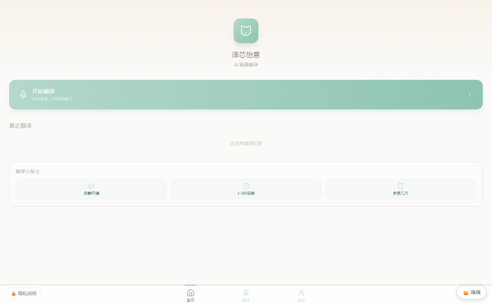
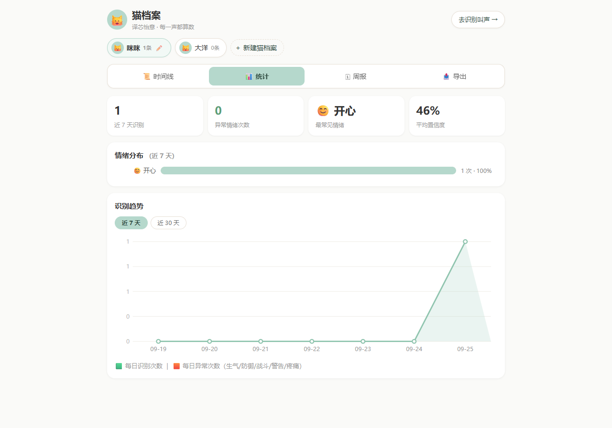

# 译芯怡意（YixinYiyi）

猫叫识别项目。网页或驻置设备录到叫声后上传，服务端先用门卫模型过滤（猫/非猫二分类），再用 10 类模型分类（呼叫、防御、疼痛等），映射成情绪和养护提示给养猫人看。门卫模型蒸馏到 MCU 的训练代码也在仓库里。



猫档案页：每只猫的时间线、情绪统计、识别趋势、记录导出。



物联网工程专业的毕业设计延伸出来的创业项目，训练、后端、前端都是自己做着学的。模型权重和数据集没有放进仓库，训练脚本里的数据路径需要自己配。

## 目录

```
train/          训练代码（PyTorch）
  train/        FDAP CNN、DS-ResNet、知识蒸馏到 MCU、TFLite/ONNX 导出
  experiments/  数据增强、事件分割实验
  eval/         评估推理，含 Wav2Vec2/HuBERT 对比
  analysis/     t-SNE 可视化
app/            Flask 服务 + SQLite
  tests/        pytest，含安全测试和部署预检
frontend/       Vue 3 + Pinia + Vite + TS
webapp/         移动端看板，原生单文件实现
docs/           技术文档和界面截图
```

## 跑起来

```bash
# 训练（FDAP CNN）
python train/train/train_fdap_cnn_v2_ch64.py

# 本地服务
python app/server.py

# 测试
cd app && python -m pytest tests/
```

## 一些记录

- 门卫模型（二分类）在服务端先过滤猫/非猫，避免人声杂音白跑 10 类模型；蒸馏到 MCU 下沉到设备的训练代码在 train/train/
- 知识蒸馏：FDAP 教师（~70K 参数，F1 ~86%）蒸到 MCU 尺寸的学生模型（logit-level KD），代码在 train/train/kd_tiny_mcu_distill.py
- 训练数据：CatSound V2 公开数据集 5925 条猫叫 + MagicData 人声负样本，内测家庭的录音和纠错反馈用于补集和验证

## 数据说明

内测用户的录音和数据不公开。接口层做了口令校验、限流，录音短存。
